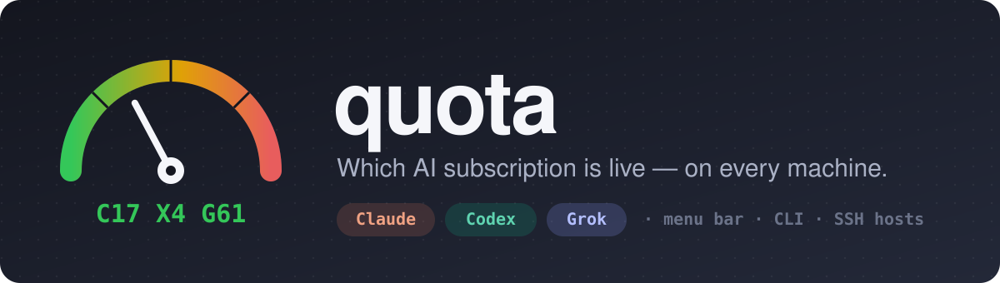
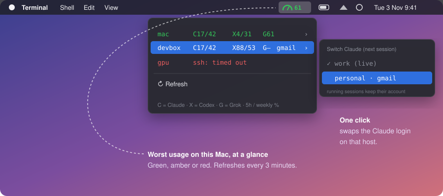
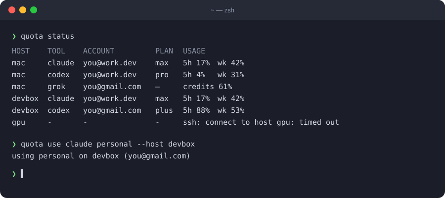
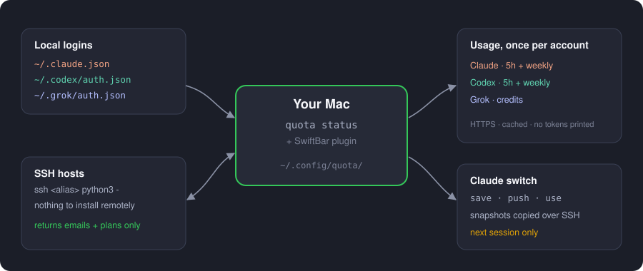

<p align="center">
  
</p>

<p align="center">
  <a href="https://github.com/abhirupghosh/quota/actions/workflows/ci.yml"></a>
  <a href="https://github.com/abhirupghosh/quota/releases/latest"></a>
  
  
  <a href="LICENSE"></a>
</p>

<p align="center">
  <b>A Mac menu bar + CLI that shows which Claude, Codex and Grok account is logged in on each of your machines, how much of its limit is left, and lets you switch Claude accounts in one click.</b>
</p>

---

You pay for more than one AI subscription. You run agents on your laptop **and** on a couple of servers. Then the 5-hour limit hits mid-task and you're left asking: *which account is this box even on? Which one still has headroom?*

`quota` answers that from the menu bar.

<p align="center">
  
</p>

## ✨ Features

- 🎯 **One glance** — the menu bar shows a gauge and this Mac's worst usage %, coloured green → amber → red.
- 🖥️ **Every machine** — one row per host (this Mac + any SSH alias). Nothing to install on the remote side; it just needs `python3`.
- 👤 **Per account, not per machine** — two hosts on the same login share one usage fetch and one number.
- 🔀 **Switch Claude accounts** — save named snapshots, push them to your hosts, and flip the next session to a different account from the menu or CLI.
- 🔒 **Tokens stay put** — remote hosts only ever send back emails and plan names. Nothing prints a token.
- 🪶 **Small** — one Go binary, standard library only, plus a tiny SwiftBar shell plugin.

## 🚀 Install

You need a Mac. [SwiftBar](https://github.com/swiftbar/SwiftBar) is optional — skip it if you only want the CLI.

**One line:**

```bash
curl -fsSL https://raw.githubusercontent.com/abhirupghosh/quota/main/install.sh | bash
```

That clones to `~/.quota`, builds with Go if you have it (otherwise downloads the release binary), links `quota` into `~/.local/bin`, and drops the plugin into SwiftBar's plugin folder.

**Then:**

```bash
brew install --cask swiftbar   # if you don't have it; pick ~/Library/Application Support/SwiftBarPlugins when asked
quota status
```

<details>
<summary><b>Other ways to install</b></summary>

**From a checkout**

```bash
git clone https://github.com/abhirupghosh/quota.git ~/.quota
~/.quota/install.sh
```

**CLI only, with Go**

```bash
go install github.com/abhirupghosh/quota/cmd/quota@latest
```

The SwiftBar plugin also looks in `~/go/bin`, so you can link [`plugin/quota.180s.sh`](plugin/quota.180s.sh) into your plugin folder by hand.

**Release binary**

Grab `quota-darwin-arm64` (Apple silicon) or `quota-darwin-amd64` (Intel) from [Releases](https://github.com/abhirupghosh/quota/releases/latest), `chmod +x` it, and put it on your `PATH` as `quota`.

**Uninstall**

```bash
~/.quota/uninstall.sh            # keeps ~/.config/quota
~/.quota/uninstall.sh --purge    # also deletes hosts + account snapshots
```

</details>

> [!NOTE]
> The binary is called `quota`. If `~/.local/bin` comes first on your `PATH` it shadows `/usr/bin/quota`, the Unix disk-quota tool. You probably never used that one.

## 🧭 Usage

<p align="center">
  
</p>

```text
quota status [--host NAME] [--json|--swiftbar]   who's logged in where, and usage
quota hosts                                      list configured hosts
quota init                                       write a starter hosts.json
quota ls                                         list saved Claude snapshots
quota save claude NAME [--host NAME]             snapshot the current Claude login
quota push [--host NAME]                         copy snapshots to remote hosts
quota use  claude NAME [--host NAME]             switch a host's Claude login
quota version
```

In the menu, `C17/42` means Claude at 17% of its 5-hour window and 42% of its weekly one. `X` is Codex, `G` is Grok (credits). A tag such as `gmail` after a row means that host is on a different account from this Mac.

## 🌐 Add your other machines

Hosts live in `~/.config/quota/hosts.json`. Out of the box it's just this Mac. Add any alias from `~/.ssh/config`:

```json
{
  "hosts": [
    { "name": "mac",    "local": true },
    { "name": "devbox", "ssh": "devbox" },
    { "name": "gpu",    "ssh": "gpu-box" }
  ]
}
```

`quota` runs `ssh -o BatchMode=yes <alias> python3 -`, so key-based auth has to work without a prompt. Tailscale MagicDNS names are fine as long as `~/.ssh/config` has the `User` and `IdentityFile`.

```bash
quota hosts
quota status --host devbox
```

## 🔀 Switching Claude accounts

```bash
# 1. Log in to account A in Claude Code, then:
quota save claude work
# 2. Log in to account B, then:
quota save claude personal
# 3. Copy snapshots to every SSH host
quota push
# 4. Point a host's next Claude session at an account
quota use claude personal --host devbox
```

Or pick from **Switch Claude** under any host in the menu.

`use` rewrites that host's `~/.claude.json` OAuth block and `~/.claude/.credentials.json` (plus the login keychain on a Mac). **Claude sessions that are already running keep their account** until they exit. Only new sessions pick up the switch.

> [!TIP]
> Save from a host that is genuinely logged in with a refresh token. On a Mac where Claude Code keeps credentials in the keychain, `~/.claude.json` can look logged in when it isn't, and that snapshot will be rejected.

Codex and Grok switching aren't built yet.

## ⚙️ How it works

<p align="center">
  
</p>

| Tool | Who's logged in | Usage source |
| --- | --- | --- |
| Claude | `~/.claude.json` → `oauthAccount` | `GET api.anthropic.com/api/oauth/usage` (`five_hour`, `seven_day`) |
| Codex | `~/.codex/auth.json` (JWT claims) | `GET chatgpt.com/backend-api/wham/usage` |
| Grok | `~/.grok/auth.json` | `GET cli-chat-proxy.grok.com/v1/billing?format=credits` |

Usage is cached for 5 minutes, so the menu refreshing every 3 minutes doesn't hammer anything. If this Mac's token for an account is rate-limited or expired, `quota` asks a remote host on the same account to fetch the numbers instead.

> [!WARNING]
> These are the same **undocumented** endpoints the official CLIs call. They can change or vanish without notice, and then that column shows `—` until `quota` catches up. Not affiliated with Anthropic, OpenAI or xAI.

## 🔒 Security

- Account snapshots **are OAuth refresh tokens**. They live in `~/.config/quota/accounts/` (mode `0700`) and only leave your Mac over SSH when you run `push` or `use`.
- Remote identity checks return email + plan only.
- Nothing is sent anywhere except the providers' own usage endpoints.
- Don't commit, paste or log anything under `~/.config/quota/accounts/`.

Found something? See [SECURITY.md](SECURITY.md).

## 🧩 SwiftBar tips

- The plugin refreshes every 3 minutes (`quota.180s.sh`). Rename it to `quota.60s.sh` for every minute.
- The title is kept short on purpose so macOS doesn't hide it on a crowded menu bar. If it vanishes anyway, hold <kbd>⌘</kbd> and drag it closer to the clock.
- Set `QUOTA_BIN` in SwiftBar's environment if your binary lives somewhere unusual.

## 🛠️ Development

```bash
make test     # go test ./...
make build    # bin/quota
```

Tests never make live usage calls. See [CONTRIBUTING.md](CONTRIBUTING.md) for the ground rules, and [`docs/`](docs/) for the design notes.

## 🗺️ Roadmap

- [x] Identity + usage for Claude, Codex, Grok across SSH hosts
- [x] SwiftBar menu
- [x] Claude account switching (future sessions)
- [ ] Codex and Grok switching
- [ ] Automatic handoff when a 5-hour window runs out
- [ ] Homebrew tap

## License

[MIT](LICENSE) © Abhirup Ghosh
